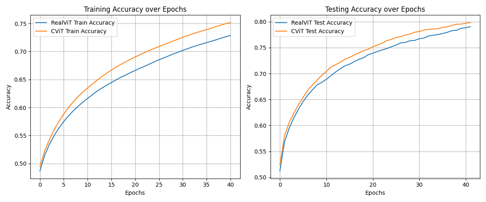
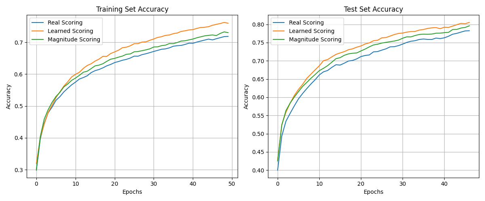

# CViT: a complex-valued Vision Transformer

Code for my BSc dissertation, *Exploring Complex-Valued Attention in Vision Transformers*
(University of Bath, 2025): a Vision Transformer whose weights, activations and attention are
complex-valued, compared against a real-valued ViT of the same size on CIFAR-10.

With strong data augmentation, the complex model reached **81% test accuracy against the real
model's 79%**, with 4% fewer real-equivalent parameters. Without augmentation it overfits and
loses (72% vs 75%). The [dissertation](docs/dissertation.pdf) has the full write-up.



## Results

From the dissertation. Each number is a single 50-epoch training run.

| Model | Parameters | Real-equivalent parameters | Test acc., no augmentation | Test acc., augmented |
|-------|-----------:|---------------------------:|---------------------------:|---------------------:|
| ViT   | 5,280,778  | 5,280,778                  | 75%                        | 79%                  |
| CViT  | 2,812,188  | 5,049,852                  | 72%                        | **81%**              |

"Real-equivalent" counts each complex weight as two real numbers, which is the fair comparison.
The tests check that this code builds models with exactly these parameter counts.

## How the complex model works

Images are real, so a two-branch convolutional stem maps each patch to a complex token (one
branch per part). From there everything is complex until the classifier, which reads the real
and imaginary parts of the class token.

| Component | Real ViT | CViT |
|---|---|---|
| Linear layers | real | complex (`nn.Linear(dtype=torch.complex64)`) |
| Attention similarity | `q · k` | Hermitian product `q · conj(k)` |
| Attention logits | the similarity | learned map of the similarity's real and imaginary parts (below) |
| Layer norm | `nn.LayerNorm` | 2D whitening of (Re, Im), adapted from Trabelsi et al.'s complex batch norm |
| Activation | GELU | split ReLU: `ReLU(Re z) + i ReLU(Im z)` |
| Initialisation | PyTorch default | complex He: Rayleigh modulus, uniform phase |

**Attention scoring** is the main design question. Softmax needs real logits, but `q · conj(k)`
is complex. The dissertation compared three ways to get them:

- **Real part**, `Re(q · conj(k))`, as in Eilers et al. It throws away half the information.
- **Magnitude**, `|q · conj(k)|`, as in Kothapally et al. It keeps how strongly two tokens
  match but drops the phase.
- **Learned** (proposed): a small real linear layer maps each query's row of scores
  `[Re s₁ … Re sₙ, Im s₁ … Im sₙ]` to `n` logits, so the model learns how to use the phase.

| Scoring | Validation accuracy |
|---|---|
| Real part | 78% |
| Magnitude | 80% |
| Learned | **81%** |



## Usage

```bash
python -m venv .venv && source .venv/bin/activate   # Windows: .venv\Scripts\activate
pip install torch torchvision                        # pick your CUDA build from pytorch.org
pip install -e ".[dev]"

# Train (downloads CIFAR-10 to ./data on first run)
python -m cvit.train --config configs/cvit.yaml
python -m cvit.train --config configs/vit.yaml --seed 1
python -m cvit.train --config configs/ablations/cvit-scoring-real.yaml --epochs 10

# Analyse finished runs
python -m cvit.analysis.curves runs/vit-seed0 runs/cvit-seed0
python -m cvit.analysis.rollout runs/vit-seed0/model.pt runs/cvit-seed0/model.pt
python -m cvit.analysis.params configs/*.yaml configs/ablations/*.yaml

pytest
```

On an RTX 4080, a 50-epoch run with augmentation took about 25 minutes for the ViT and about 50
for the CViT. A complex multiplication costs four real ones.

## Layout

```
configs/                  model and training settings (YAML)
  vit.yaml, cvit.yaml     the two models compared in the dissertation
  ablations/              CViT variants: scoring, layer norm, activation, patch stem
src/cvit/
  complex_nn.py           complex activations, dropout, layer norms, initialisation
  attention.py            multi-head self-attention, real or complex
  model.py                ViT / CViT built from a ViTConfig; checkpointing
  data.py                 CIFAR-10 loaders and augmentation
  train.py                training CLI
  analysis/               attention rollout, training curves, parameter counts
tests/                    unit tests and a toy-problem training test
docs/                     dissertation and figures
```

## Changes since the dissertation

This is a rewrite of the dissertation code, which had four near-duplicate model classes and
switched experiments by commenting lines in and out. The rewrite builds the same architectures
(the parameter counts match exactly) and fixes the bugs below, so a re-run will not give exactly
the numbers above:

- **Complex layer norm**: the stabilising epsilon was also added to the off-diagonal covariance
  term, and the learned scale matrix was not symmetric. Both now follow Trabelsi et al.
- **Complex initialisation**: the Rayleigh scale was `1/fan_in` rather than `1/sqrt(fan_in)`,
  and a convolution's fan-in ignored its kernel size.
- **Attention rollout**: layers were multiplied in the wrong order, and the real model's
  attention went through softmax twice. The dissertation's rollout figures are affected, so
  they are not reproduced here.
- **Training**: crashed when saving if the output folder did not exist. Runs are now seeded and
  write their config and metrics.

## Limitations

- Every result is a single run, so a 2-point difference is close to seed-to-seed noise.
- The learned scoring layer adds about 8,500 parameters per block that the real ViT does not
  get. A ViT with an equivalent layer would separate the effect of complex numbers from the
  effect of the extra layer.
- The scoring layer's size depends on the number of tokens, so a trained model only works at
  one image size.

## Citation

```bibtex
@thesis{bronowicki2025cvit,
  author = {Bronowicki, Jakub},
  title  = {Exploring Complex-Valued Attention in Vision Transformers},
  school = {University of Bath},
  type   = {BSc dissertation},
  year   = {2025}
}
```
